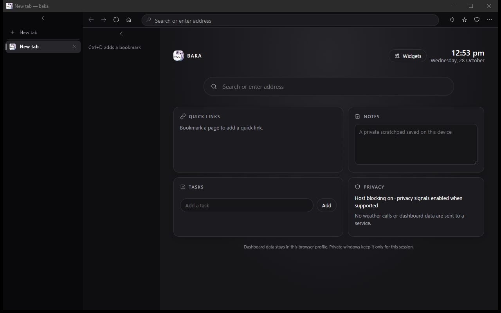
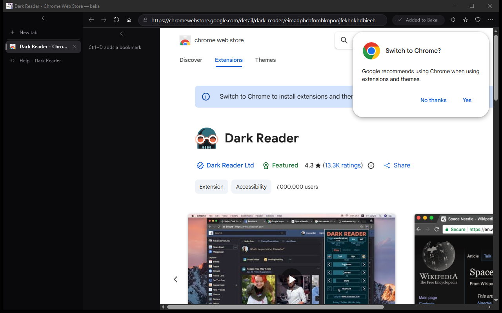
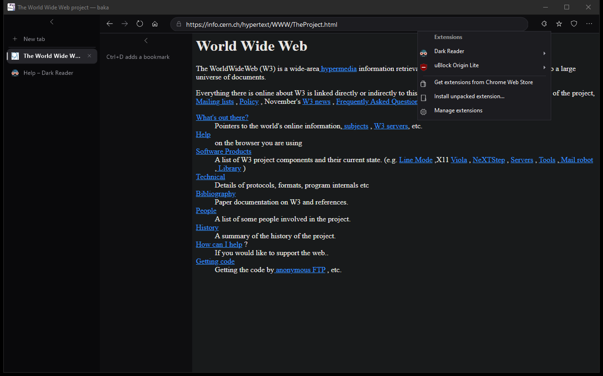
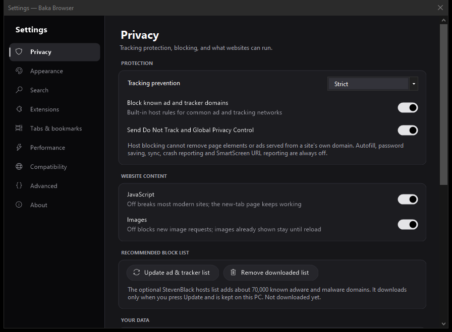
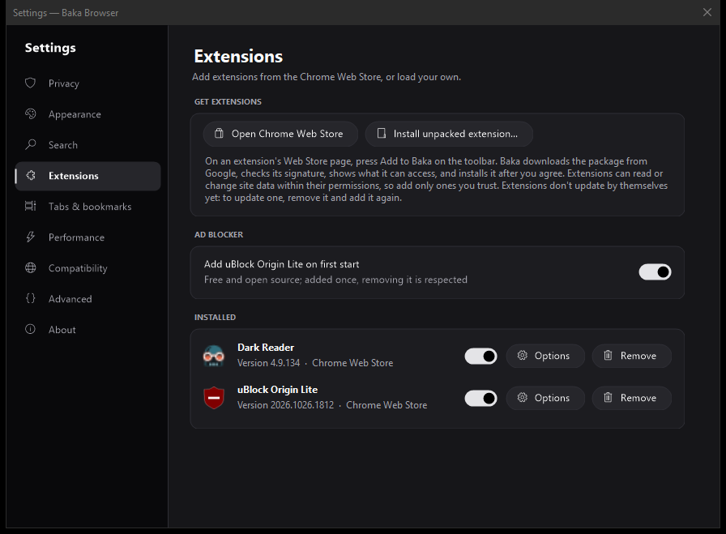
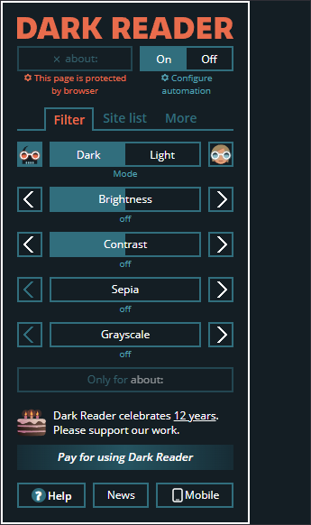
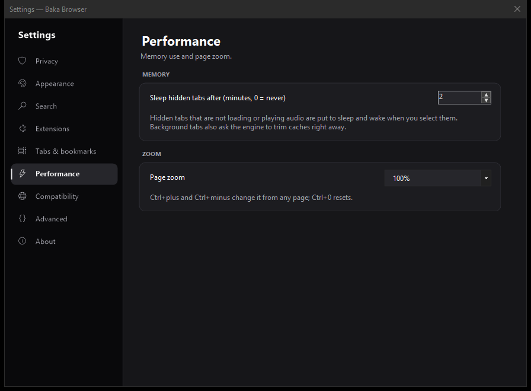

# Baka Browser

A small, private Windows browser with Chrome Web Store extensions, a compact graphite look, and quiet updates. It is the default browser of [BAKA Windows](https://github.com/OldcarryG/Baka-windows) and runs on any Windows 10 or 11 PC. Written in C# and WinForms on Microsoft Edge WebView2 (Chromium).



| Chrome Web Store | Extensions menu | Settings |
|---|---|---|
|  |  |  |

| uBlock Origin Lite built in (1.5) | Extension popups | Performance settings (1.5) |
|---|---|---|
|  |  |  |

**[Download the latest release](https://github.com/OldcarryG/Baka-browser/releases/latest)**: run `BakaBrowser-win-Setup.exe`.

## Install

Download `BakaBrowser-win-Setup.exe` from [GitHub Releases](https://github.com/OldcarryG/Baka-browser/releases). The one-click Velopack installer installs per user, creates shortcuts, and starts the browser when setup finishes. It does not require administrator access. If the WebView2 Runtime is missing, setup downloads and installs it.

The release workflow creates a self-contained x64 Windows package. Users do not need to install .NET separately. A network connection is needed for the first WebView2 Runtime install and for automatic updates.

### Automatic updates

Installed copies check for updates after startup and then every six hours. Available updates download quietly and are applied the next time the browser starts, without interrupting an open browsing session. The setting **Check for updates automatically** turns background checks off or on. Copies started with `dotnet run` are development builds and do not self-update.

The installer and update packages are not Authenticode-signed in this repository, so Windows SmartScreen may show an unknown-publisher warning. Signing requires a code-signing certificate and protected release credentials.

## Features

- **Tabs and window controls:** Place tabs on the left or top, collapse the left tab rail, and restore up to 50 regular tabs from the previous session.
- **Fullscreen:** Choose true fullscreen or maximize the page while keeping browser controls visible.
- **Privacy:** WebView2 tracking prevention, built-in host rules, optional downloaded ad/tracker domains, Do Not Track and Global Privacy Control signals, JavaScript and image switches, and site-data clearing.
- **uBlock Origin Lite by default:** New profiles get the free, open-source [uBlock Origin Lite](https://github.com/uBlockOrigin/uBOL-home) from the Chrome Web Store on first start, for element hiding and filter-list blocking. It is added once; removing it is respected. Switch: Settings > Extensions > Ad blocker.
- **Uploads and 4K video:** The UI test uploads a photo and a 40 MB video by form, `fetch` and chunked XHR, and checks 4K60 VP9, AV1 and H.264 decoding (hardware decoding on a supported GPU). HEVC needs Microsoft's HEVC codec.
- **Ad and tracker blocking:** Built-in and custom rules block whole domains. Settings can manually download the [StevenBlack hosts list](https://github.com/StevenBlack/hosts), keep it locally, and remove it later. The update sends a request to GitHub for the list; it does not include visited URLs or tab data.
- **Site exceptions:** Allowed domains bypass matching block rules for that domain and its subdomains.
- **Private windows:** Open from the toolbar or with `Ctrl+Shift+N`. Private browsing uses a temporary WebView2 profile and does not save history, session tabs, or dashboard edits. Downloaded files remain where you save them.
- **Chrome Web Store extensions:** Open an extension on the [Chrome Web Store](https://chromewebstore.google.com/) and press **Add to Baka** on the toolbar. The browser downloads the signed package from Google, verifies the CRX3 signature against the extension ID, shows the permissions, and installs after you agree. The puzzle button opens popups and options, turns extensions off or on, and removes them. Unpacked extensions can be loaded from a folder. Needs WebView2 Runtime 120 or newer; off in private windows. Store extensions do not auto-update yet: remove and re-add to update.
- **Menu and shortcuts:** ⋯ menu (Alt+F) with new tab, private window, history (Ctrl+H), downloads (Ctrl+J), bookmarks bar (Ctrl+Shift+B), extensions (Ctrl+Shift+E), zoom (Ctrl+plus/minus/0), print (Ctrl+P), full screen (F11) and settings (Ctrl+,).
- **New-tab dashboard:** Show or hide widgets, add notes and tasks, and choose a local image or video background. Images are limited to 25 megapixels; video files have no application-level size limit. Videos are muted and pause when their tab is hidden.
- **Customization:** BAKA (default), Dark, Light or Custom themes; accent color; left or top tab and bookmark layouts; custom Windows cursor; glass effects for the Dark and Light themes.
- **Settings:** a section rail (Privacy, Appearance, Search, Extensions, Tabs & bookmarks, Performance, Compatibility, Advanced, About) with switches and an update check.
- **Local data protection:** Optional Windows EFS encryption for the browser data directory. EFS protects files at rest for the signed-in Windows account; it is not a password prompt and does not protect an unlocked account.
- **History and bookmarks:** Stored locally; there is no browser account or cloud sync.

### Ad-blocking limits

Blocking is domain-based, not a full EasyList-style filter engine. It cannot hide ad elements or reliably block ads delivered from the same domain as the page. A block rule can also interfere with site features. Turn off host blocking, remove the downloaded list, or add an allowed domain if a site breaks. The downloaded list is refreshed only when the user presses its update button.

### Data locations

Browser settings, profile data, bookmarks, history, downloaded block rules, and dashboard data are stored under `%LOCALAPPDATA%\baka-browser\`. Session restore stores page URLs in `settings.json`. The Velopack application files are installed separately under `%LOCALAPPDATA%\BakaBrowser\`. Uninstalling the browser leaves its profile and local data in place.

Private profiles use a temporary `baka-private-<guid>` directory and are deleted on close where Windows allows. A process crash can leave a temporary folder behind for Windows to clean up.

## Build from source

Requirements: Windows x64 and the .NET 10 SDK. A development run also needs the WebView2 Runtime installed.

```powershell
dotnet restore baka.csproj --configfile nuget.config
dotnet build baka.csproj -c Release --no-restore
dotnet run --project baka.csproj -c Release
```

Tests:

```powershell
baka.exe --self-check                                   # unit checks, prints "all passed"
baka.exe --profile-dir $env:TEMP\baka-test --ui-test .\ui-report   # drives the real UI, installs two store extensions into the throwaway profile, saves screenshots
```

`--profile-dir <folder>` runs the browser with a separate profile, so testing never touches your own data.

## Create a release

Releases are built by GitHub Actions when a `vMAJOR.MINOR.PATCH` tag is pushed. The workflow validates the tag against `<Version>` in `baka.csproj`, publishes a self-contained Windows build, packages the one-click installer and update files with Velopack, bootstraps WebView2, and publishes the GitHub Release with `RELEASE_NOTES.md`.

See [GITHUB_UPLOAD_GUIDE.md](GITHUB_UPLOAD_GUIDE.md) for the safe, step-by-step process to copy these changes into the existing repository and publish a release. See [CHANGELOG.md](CHANGELOG.md) for the version history.

## Known limits and release notes

- The rendering engine is WebView2 (Chromium). Extensions run with WebView2's extension support, which covers most but not all Chrome extension APIs.
- The included installer targets Windows x64 only. There is no macOS or Linux build.
- Windows may show a SmartScreen warning until the release is signed with a trusted code-signing certificate.
- Background tabs ask WebView2 to trim memory (`MemoryUsageTargetLevel = Low`) as soon as they are hidden. Idle-tab suspension is best-effort and controlled in Settings. It reduces background work but does not cap the memory used by an active page.
- The browser has no bookmark folders, built-in proxy, or cloud sync.

## License

Keep the license already present in the GitHub repository. No `LICENSE` file was included in the source snapshot used to prepare this release, so no license has been selected here.
