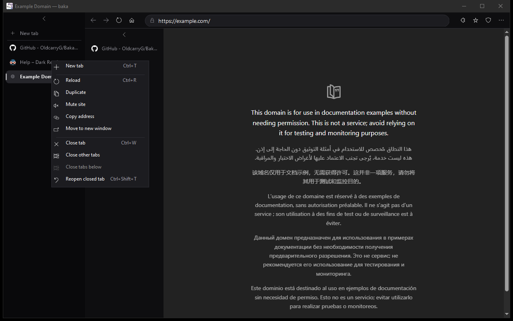

# Baka Browser

A small, private Windows browser with Chrome Web Store extensions, uBlock Origin Lite built in, a compact graphite look, and quiet updates. It is the default browser of [BAKA Windows](https://github.com/OldcarryG/Baka-windows) and runs on any Windows 10 or 11 PC. Written in C# and WinForms on Microsoft Edge WebView2, so pages render with the same Chromium engine as Edge and Chrome.

**[Download the latest release](https://github.com/OldcarryG/Baka-browser/releases/latest)**: run `BakaBrowser-win-Setup.exe`. Current version: **1.6.2**.


- [Screenshots](#screenshots)
- [At a glance](#at-a-glance)
- [Install](#install)
- [Features](#features)
- [Keyboard shortcuts](#keyboard-shortcuts)
- [Privacy and ad blocking](#privacy-and-ad-blocking)
- [Extensions](#extensions)
- [Performance](#performance)
- [Baka Browser compared with Edge](#baka-browser-compared-with-edge)
- [Data locations](#data-locations)
- [Version history](#version-history)
- [Build from source](#build-from-source)
- [Tests](#tests)
- [Create a release](#create-a-release)
- [Known limits](#known-limits)

## Screenshots

| Chrome Web Store | Extensions menu | Settings |
|---|---|---|
|  |  |  |

| uBlock Origin Lite built in | Extension popups | Performance settings |
|---|---|---|
|  |  |  |



## At a glance

| | |
|---|---|
| Engine | Chromium through Microsoft Edge WebView2 (the evergreen runtime updates itself with Windows) |
| Platform | Windows 10 or 11, x64 |
| Install | Per user, no administrator rights, one-click Velopack installer; WebView2 installed if missing |
| Updates | Checked at start and every six hours, downloaded quietly, applied at the next start |
| Ad blocking | uBlock Origin Lite on first start, plus built-in domain rules and an optional StevenBlack hosts list |
| Extensions | Chrome Web Store, with CRX3 signature check and a permission prompt; unpacked extensions from a folder |
| Privacy | Tracking prevention, Do Not Track and Global Privacy Control, private windows, optional EFS encryption of the profile, no account and no cloud sync |
| Video | 4K60 VP9, AV1 and H.264 (hardware decoding on a supported GPU); HEVC with Microsoft's HEVC extension |

## Install

1. Download `BakaBrowser-win-Setup.exe` from [GitHub Releases](https://github.com/OldcarryG/Baka-browser/releases).
2. Run it. It installs for your Windows user, creates shortcuts, and starts the browser. No administrator approval is needed.
3. If the WebView2 Runtime is missing, setup downloads and installs it. It is already part of Windows 11 and of BAKA Windows.

The release is a self-contained x64 build, so .NET does not need to be installed. A network connection is needed for the first WebView2 install and for updates.

**Automatic updates.** Installed copies check for updates after startup and then every six hours. An update downloads in the background and is applied the next time the browser starts, so an open session is never interrupted. Settings > About has a manual check, and **Check for updates automatically** turns background checks off. Copies started with `dotnet run` are development builds and do not update themselves.

The installer and update packages are not Authenticode-signed, so Windows SmartScreen may show an unknown-publisher warning. Signing needs a code-signing certificate.

## Features

### Tabs and windows
- Tabs on the left (a rail that can be collapsed) or on top.
- Up to 50 regular tabs restored from the previous session.
- **Right-click a tab**: New tab, Reload, Duplicate, Mute or unmute site, Copy address, Move to new window, Close tab, Close other tabs, Close tabs below (or to the right), Reopen closed tab.
- **Drag a tab** along the strip to reorder it, or drag it off the strip to open it in its own window where you drop it.
- **Sound indicator**: a speaker on tabs that play audio; click it to mute the site.
- **Reopen closed tabs** with `Ctrl+Shift+T` (the last 25).
- **Fullscreen**: true fullscreen (F11), or maximize the page while keeping the browser controls visible.

### New-tab dashboard
- Widgets you can show or hide, quick links with site icons, notes and tasks.
- Background: a local picture (up to 25 megapixels) or a video (.mp4, .webm; no size limit). Videos are muted, can seek, and pause when their tab is hidden.

### Look
- Themes: **BAKA** (default, the BAKA Windows graphite palette), Dark, Light, Custom.
- Accent colour, left or top tabs and bookmarks, compact 40 px toolbar, custom Windows cursor, glass effects for Dark and Light.

### Menu and settings
- ⋯ menu (`Alt+F`): new tab, private window, history, downloads, bookmarks bar, extensions, zoom, print, full screen, settings.
- Settings has a section rail: Privacy, Appearance, Search, Extensions, Tabs & bookmarks, Performance, Compatibility, Advanced, About.

### History and bookmarks
- Stored on your PC only. There is no browser account and no cloud sync.
- `Ctrl+D` bookmarks the page; the bookmarks bar can be shown or hidden with `Ctrl+Shift+B`.

### Uploads and video
- The UI test uploads a 3 MB photo and a 40 MB video by form, `fetch`/`FormData` and chunked `XMLHttpRequest`.
- It checks 4K60 VP9, AV1 and H.264 decoding. With a supported GPU the video is decoded in hardware. HEVC needs Microsoft's HEVC extension (BAKA Windows installs it).

## Keyboard shortcuts

| Keys | Action |
|---|---|
| `Ctrl+T` | New tab |
| `Ctrl+W` | Close tab |
| `Ctrl+Shift+T` | Reopen closed tab (last 25) |
| `Ctrl+1` … `Ctrl+8` / `Ctrl+9` | Go to tab 1 to 8 / the last tab |
| `Ctrl+Shift+N` | New private window |
| `Ctrl+L`, `Alt+D` | Address bar |
| `Ctrl+R`, `F5` | Reload |
| `Ctrl+D` | Bookmark this page |
| `Ctrl+Shift+B` | Show or hide the bookmarks bar |
| `Ctrl+H` | History |
| `Ctrl+J` | Downloads |
| `Ctrl+Shift+E` | Extensions menu |
| `Ctrl+plus`, `Ctrl+minus`, `Ctrl+0` | Zoom in, out, reset |
| `Ctrl+P` | Print |
| `F11` | Full screen (`Esc` leaves it) |
| `Ctrl+,` | Settings |
| `Alt+F` | Main menu |

## Privacy and ad blocking

- **uBlock Origin Lite by default.** New profiles get the free, open-source [uBlock Origin Lite](https://github.com/uBlockOrigin/uBOL-home) from the Chrome Web Store on first start. It hides ad elements and blocks by filter lists. It is added once per profile; if you remove it, it stays removed. Switch: Settings > Extensions > Ad blocker.
- **Built-in domain blocking.** Built-in and custom rules block whole domains. Settings can download the [StevenBlack hosts list](https://github.com/StevenBlack/hosts) (adware and malware), keep it locally and remove it again. The download asks GitHub for the list only; it sends no visited URLs or tab data. The list is refreshed only when you press its update button.
- **Site exceptions.** Allowed domains bypass block rules for that domain and its subdomains.
- **Tracking prevention** (WebView2's strict level), **Do Not Track** and **Global Privacy Control** signals, switches for JavaScript and images, and clearing of site data.
- **Private windows** (`Ctrl+Shift+N`) use a temporary profile and save no history, session tabs or dashboard edits. Files you download stay where you saved them.
- **Profile encryption (optional).** Windows EFS can encrypt the browser data folder. It protects the files at rest for your Windows account; it is not a password prompt and does not protect an unlocked account.
- **Inside BAKA Windows** every app, including this browser, also goes through BAKA's encrypted AdGuard DNS and hosts block list.

**Limits of the domain blocking.** Domain rules cannot hide ad elements or block ads served from the page's own domain; uBlock Origin Lite covers that. A block rule can break a site feature. Turn off host blocking, remove the downloaded list, or add the site as an allowed domain if a site breaks.

## Extensions

- Open an extension on the [Chrome Web Store](https://chromewebstore.google.com/) and press **Add to Baka** on the toolbar.
- The browser downloads the signed `.crx` package from Google's update service over HTTPS, **verifies its CRX3 signature against the extension ID**, unpacks it with size and path checks (no files outside the extension folder), keeps the store key so the extension keeps its store ID, and **shows the requested permissions** before installing.
- The puzzle button (`Ctrl+Shift+E`) opens extension popups and options pages, turns extensions on or off, and removes them.
- Unpacked extensions can be loaded from a folder (Settings > Extensions).
- Needs WebView2 Runtime 120 or newer. Extensions are off in private windows.
- WebView2 supports most, but not all, Chrome extension APIs. Store extensions do not update by themselves yet: remove and add one again to update it.

## Performance

- Background tabs ask WebView2 to use less memory (`MemoryUsageTargetLevel = Low`) as soon as they are hidden; the tab in front goes back to normal. Tabs playing audio keep the normal level.
- Idle background tabs can be suspended (Settings > Performance). Suspension waits while a tab is loading or playing audio.
- This lowers background work but does not cap the memory of the page you are using.

## Baka Browser compared with Edge

| | Microsoft Edge | Baka Browser |
|---|---|---|
| Engine | Chromium | Chromium (through the WebView2 runtime that ships with Windows) |
| Ad blocking | None by default | uBlock Origin Lite on first start, plus domain rules |
| Tracking prevention | Balanced by default | Strict |
| Account and sync | Microsoft account, cloud sync | No account, everything stays on the PC |
| Shopping, Copilot, news feed on the new tab | Yes | No; a local dashboard with notes, tasks and your own picture or video |
| Chrome Web Store extensions | Yes | Yes, with signature check and permission prompt |
| Updates | Edge Update service | Velopack, per user, applied at the next start |
| Install rights | Machine-wide | Per user, no administrator rights |

## Data locations

| What | Where |
|---|---|
| Settings, profile, bookmarks, history, block lists, dashboard | `%LOCALAPPDATA%\baka-browser\` |
| Session restore (page URLs) | `settings.json` in that folder |
| Program files | `%LOCALAPPDATA%\BakaBrowser\` |
| Private windows | a temporary `baka-private-<guid>` folder, deleted on close where Windows allows |

Uninstalling the browser leaves your profile in place. A crash can leave a temporary private folder behind for Windows to clean up.

## Version history

| Version | Date | Changes |
|---|---|---|
| **1.6.2** | 2026-10-28 | A video picked as the new-tab background now plays: the browser serves the file itself with byte-range (seeking) support. The UI test checks a .webm and an .mp4 clip. |
| 1.6.1 | 2026-10-28 | "Choose image or video…" for the new-tab background works on a new profile (the folder is created first). |
| 1.6.0 | 2026-10-28 | Tab menu, drag tabs to reorder or into a new window, mute button, `Ctrl+Shift+T`, `Ctrl+1`…`9`. Fixes: closing a background tab kept the wrong tab selected; `Ctrl+W` inside a page; zoom on open tabs. Detached windows no longer overwrite the main window's session. |
| 1.5.0 | 2026-10-28 | uBlock Origin Lite on first start, lower memory for background tabs, upload and 4K decoding self-tests. |
| 1.4.0 | 2026-10-28 | Chrome Web Store install with CRX3 signature check, extensions menu, main menu, zoom, print, site icons, redesigned Settings, flat BAKA theme. |
| 1.3.0 | – | Not published; its BAKA theme shipped in 1.4.0. |
| 1.2.0 | 2026-10-10 | Velopack installer and automatic updates, StevenBlack hosts list download, GitHub build and release workflows. |

Full details: [CHANGELOG.md](CHANGELOG.md).

## Build from source

Requirements: Windows x64, the .NET 10 SDK, and the WebView2 Runtime.

```powershell
dotnet restore baka.csproj --configfile nuget.config
dotnet build baka.csproj -c Release --no-restore
dotnet run --project baka.csproj -c Release
```

## Tests

```powershell
baka.exe --self-check                                              # unit checks, prints "all passed"
baka.exe --profile-dir $env:TEMP\baka-test --ui-test .\ui-report   # drives the real UI and saves screenshots
```

- `--self-check` covers store URLs, CRX parsing, signature and ID checks, tampered packages, zip-slip paths and the new-tab background folder.
- `--ui-test` opens tabs, bookmarks, zooms, uses the tab menu, reorders, reopens and tears off tabs, mutes a tab, installs two store extensions, uploads a photo and a 40 MB video, checks 4K decoding, and sets a .webm and an .mp4 background and checks that they play. It writes a report and screenshots.
- `--profile-dir <folder>` runs the browser with a separate profile, so testing never touches your own data.

## Create a release

Releases are built by GitHub Actions when a `vMAJOR.MINOR.PATCH` tag is pushed. The workflow checks the tag against `<Version>` in `baka.csproj`, publishes a self-contained Windows build, packages the installer and update files with Velopack, bootstraps WebView2, and publishes the GitHub Release with `RELEASE_NOTES.md`.

See [GITHUB_UPLOAD_GUIDE.md](GITHUB_UPLOAD_GUIDE.md) for the step-by-step process.

## Known limits

- The engine is WebView2 (Chromium). Extensions use WebView2's extension support, which covers most but not all Chrome extension APIs.
- Store extensions do not update by themselves yet.
- A tab dragged into a new window reloads its page there (it is a separate browser process).
- Windows x64 only; no macOS or Linux build.
- Windows may show a SmartScreen warning until releases are signed.
- No bookmark folders, built-in proxy or cloud sync.

## License

Keep the license already present in the GitHub repository. No `LICENSE` file was included in the source snapshot used to prepare this release, so no license has been selected here.
